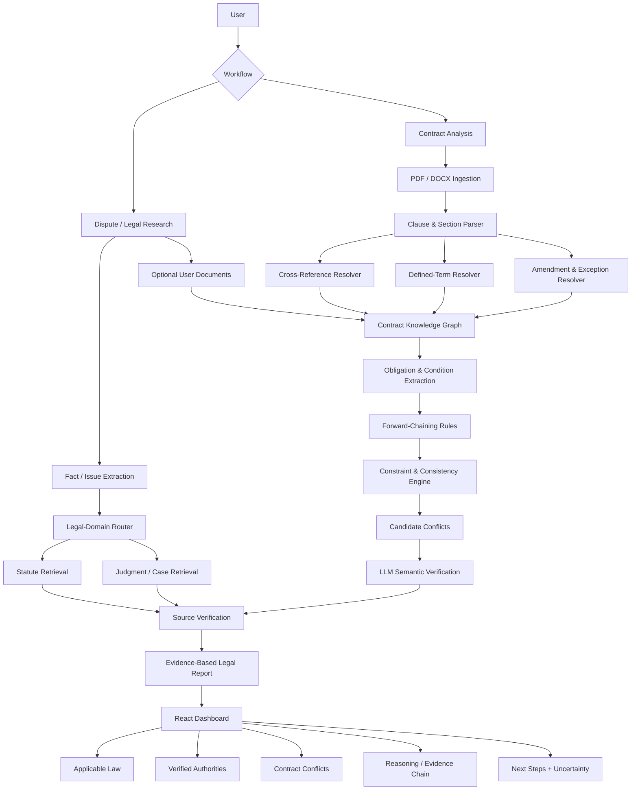

# LexVigil — AI Legal Intelligence Platform

## Cross-Reference-Aware Contract Analysis, Legal Research, Dispute Intelligence & Explainable Reasoning

**Tagline:** *Understand the law. Verify the precedent. Analyze the contract. Know your next step.*

**Project Type:** LegalTech / NLP / Retrieval-Augmented Generation / Symbolic Reasoning / Full-Stack Web Application  
**Primary Geography:** India  
**Primary Users:** Individuals, advocates, legal researchers, law students, NGOs, compliance teams and contract-review teams  
**Status:** Final project specification  

---

## 1. Executive Summary

LexVigil is an explainable AI-powered legal intelligence platform for Indian legal research, dispute issue-spotting and contract analysis. Its defining technical capability is **cross-reference-aware reasoning**: instead of treating every contract clause as an isolated text fragment, LexVigil resolves internal references, defined terms, amendments, exceptions and clause dependencies before evaluating whether the resulting obligations are mutually consistent.

The broader platform extends this contract-analysis core with a source-grounded legal research layer. Users can describe a criminal, civil, family, property, consumer, labour or other legal dispute and receive a structured analysis containing potentially relevant legal provisions, verified authorities, issue summaries, possible procedural next steps, supporting evidence and uncertainty warnings. The platform is designed as a **legal research and decision-support system**, not as an autonomous advocate or a substitute for a qualified lawyer.

The architecture deliberately avoids an LLM-only approach. The pipeline combines:

1. deterministic document parsing and clause segmentation,
2. cross-reference and defined-term resolution,
3. a structured contract/dependency graph,
4. symbolic rule and constraint reasoning,
5. authoritative legal-source retrieval,
6. LLM-assisted semantic verification and explanation, and
7. evidence-first presentation with source provenance.

The design is motivated by a practical observation: legal analysis often depends on relationships between clauses, statutes, exceptions and precedents rather than on isolated sentences. Recent legal-NLP research similarly highlights the difficulty of multi-clause reasoning and the value of structured clause-dependency representations.

---

## 2. Core Product Vision

### 2.1 Vision

> Build a privacy-conscious, evidence-grounded legal intelligence assistant that helps users understand Indian law, analyze contractual language, identify possible legal issues, and trace each important conclusion back to its source.

### 2.2 Product positioning

LexVigil should **not** be marketed as “an AI advocate that replaces lawyers.” The technically and legally stronger positioning is:

> **LexVigil is an AI-assisted legal research, dispute issue-spotting and contract-intelligence system that helps users and lawyers reason over legal documents and verified authorities.**

### 2.3 Product pillars

| Pillar | Purpose |
|---|---|
| Legal Intelligence | Map user facts to potentially relevant legal domains, statutes and procedures |
| Contract Intelligence | Resolve cross-references, definitions, amendments and contradictions |
| Verified Research | Retrieve primary/official sources and verified case references |
| Explainable Reasoning | Show how conclusions were derived and which evidence supports them |
| Privacy | Minimize retention, isolate secrets and provide deletion controls |
| Human-in-the-loop | Clearly surface uncertainty and require professional review for high-stakes decisions |

---

## 3. Problem Statement

### 3.1 Legal problem

Long legal documents are structurally difficult. A contract may define a term in one section, reference it in several others, amend it later, and then apply an exception somewhere else. A simple keyword search can find those passages but cannot reliably determine the **effective legal state** created by their interaction.

The same problem appears in legal research. A user may describe a dispute using everyday language while the legally relevant concepts appear under different statutory terminology. Identifying the relevant provisions, procedures, exceptions and precedents requires retrieval plus reasoning, not just generation.

### 3.2 Representative contract example

```text
Section 4.2
“Payment Period” means 30 days.

        │ defines
        ▼

Section 8.1
Buyer shall make payment within the Payment Period.

        │ later amendment
        ▼

Section 17.3
The Payment Period is amended to 45 days.

        │ related obligation elsewhere
        ▼

Section 12.4
A late-payment charge applies after 30 days.
```

A naive LLM may summarize all four clauses without recognizing that they produce a potentially inconsistent effective state.

LexVigil should instead derive:

```text
Effective Payment Period = 45 days
Late-Payment Trigger      = 30 days

Potential conflict between §12.4 and §17.3.
Review required to determine whether §12.4 was also intended to be amended.
```

### 3.3 Representative dispute example

User input:

> “My landlord has retained my ₹80,000 security deposit for six months and refuses to respond.”

LexVigil should structure the issue as:

```text
Facts
  ↓
Potential legal issues
  ↓
Relevant legal domains
  ↓
Applicable statutes / sections
  ↓
Verified authorities / precedents
  ↓
Contract terms, if provided
  ↓
Potential remedies / procedure
  ↓
Evidence checklist
  ↓
Uncertainty + professional review warning
```

The system must distinguish **possible legal relevance** from a definitive judicial conclusion.

---

## 4. Objectives

### Primary objective

Develop an evidence-grounded legal intelligence platform that can reason across long-form legal documents and verified legal sources while preserving traceability.

### Specific objectives

1. Parse PDF and DOCX contracts into a structured clause hierarchy.
2. Resolve internal cross-references such as “Section 4.2,” “Clause 7(b),” and “as defined above.”
3. Resolve defined terms, including nested and chained definitions.
4. Detect amendments, superseding clauses, exceptions and temporal dependencies.
5. Represent clause relationships as a contract knowledge graph.
6. Extract obligations, permissions, prohibitions, quantities, dates, thresholds and conditions.
7. Use deterministic forward-chaining and constraint checks to propagate effective contractual facts.
8. Detect candidate contradictions across related clauses.
9. Retrieve authoritative legal sources for user-described disputes and contract questions.
10. Verify case citations before presenting them to the user.
11. Use an LLM for semantic interpretation and explanation rather than delegating all legal conclusions to the model.
12. Present evidence chains, source provenance, confidence and uncertainty.
13. Evaluate the system against rule-only and LLM-only baselines.

---

## 5. Scope

### 5.1 MVP scope

The MVP should support:

- PDF and DOCX contract ingestion.
- Clause and section segmentation.
- Cross-reference extraction and resolution.
- Defined-term extraction and lookup.
- Amendment and exception detection.
- Structured clause/dependency graph.
- Obligation and condition extraction for selected patterns.
- Numeric, temporal, obligation, definition, scope and amendment conflict detection.
- Legal-domain issue classification for a controlled set of Indian law domains.
- Retrieval of verified statutory and case sources from trusted/official sources where available.
- Source-linked natural-language explanations.
- Interactive conflict/evidence dashboard.
- Case/dispute analysis workflow.
- Confidence and uncertainty labels.
- Secure file handling and deletion controls.

### 5.2 Out of scope for MVP

- Autonomous court representation.
- Filing or prosecuting a case on the user's behalf.
- Unsupervised legal advice with guaranteed outcomes.
- Complete coverage of every Indian statute and every judgment.
- Fully automated legal document drafting without human review.
- Guaranteed jurisdictional outcomes.
- Reliance on unverified case citations.

---

## 6. Legal-Domain Coverage Strategy

LexVigil should use an extensible legal knowledge architecture instead of hard-coding one law into the backend.

### 6.1 Initial domains

| Domain | Example source families |
|---|---|
| Criminal | BNS, BNSS and related subordinate rules |
| Civil procedure | CPC and related procedural sources |
| Contracts | Indian Contract Act and relevant commercial law |
| Consumer | Consumer Protection Act and related rules |
| Property | Transfer of Property Act, registration/property-related statutes |
| Family | Relevant personal/family statutes based on the user's facts |
| Labour | Applicable labour statutes/codes and rules |
| Cyber / IT | Information Technology Act and applicable rules |

**Important:** the platform should maintain a source registry so that laws, rules, amendments and effective dates can be updated without changing the reasoning engine.

### 6.2 Criminal-law terminology

For current Indian criminal-law workflows, the product should distinguish **Bharatiya Nyaya Sanhita (BNS)** for substantive criminal offences from **Bharatiya Nagarik Suraksha Sanhita (BNSS)** for criminal procedure. Legacy IPC/CrPC references may be retained as historical/transition references where relevant, but should not be presented as if they are the sole current criminal-law framework.

---

## 7. Core Functional Modules

## 7.1 Document Ingestion Module

### Inputs

- PDF
- DOCX

### Responsibilities

- text extraction
- page preservation
- heading detection
- section-number preservation
- document metadata
- OCR fallback for scanned documents, where required
- source-location tracking

### Suggested technologies

- PyMuPDF
- python-docx
- optional OCR fallback for image-only documents

---

## 7.2 Clause and Section Parser

Convert raw text into structured objects:

```json
{
  "id": "4.2",
  "title": "Payment Period",
  "text": "Payment Period means thirty (30) days...",
  "page": 8,
  "parent": "4"
}
```

The parser must preserve the mapping:

```text
document → page → section → subsection → sentence
```

This provenance is required for explainability.

---

## 7.3 Cross-Reference Resolver

Detect reference expressions such as:

```text
Section 4.2
Clause 7(b)
Section 10
as defined in Section 3.1
subject to Section 12
pursuant to Clause 8
notwithstanding Section 6
```

Represent relationships such as:

```text
8.1  ──references──> 4.2
12.4 ──subject_to──> 8
17.3 ──amends──────> 4.2
```

### Resolution strategy

1. Normalize section identifiers.
2. Match exact references.
3. Match relative references such as “this Section” or “the foregoing.”
4. Resolve heading aliases and numbering variations.
5. Detect unresolved references.
6. Assign a resolution confidence.
7. Preserve both the raw reference and resolved target.

---

## 7.4 Defined-Term Resolver

Detect patterns such as:

> “Business Day means…”

> “Payment Period shall have the meaning assigned in Section 4.2.”

Build:

```text
Business Day
      ↓
Definition §2.4
      ↓
Used by §9.1
```

Nested definitions are represented as a graph:

```text
Working Day
   ↓ synonym / alias
Business Day
   ↓ definition
Calendar rule
```

---

## 7.5 Amendment and Precedence Resolver

The effective state of a contract cannot be determined by treating every occurrence of a term as equally active.

Example:

```text
Original §4.2:
Payment Period = 30 days

Amendment §17.3:
Payment Period = 45 days
```

The effective state becomes:

```text
Payment Period = 45 days
```

The system keeps both values for provenance but uses the later explicit amendment when evaluating downstream clauses, subject to any stated precedence or scope restrictions.

---

## 7.6 Exception Resolver

Legal contracts frequently use:

- provided that
- except
- notwithstanding
- unless
- subject to
- except as otherwise provided

These expressions can change the scope of a general rule.

Example:

```text
General rule:
Termination requires 60 days notice.

Exception:
Except in the event of material breach, where immediate termination is permitted.
```

The reasoning engine must not flag this as a contradiction simply because the numbers or verbs differ. It must model the **condition under which the exception becomes active**.

---

## 7.7 Contract Knowledge Graph

The graph is the central structural representation.

### Node types

```text
Contract
Section
Clause
Definition
Term
Obligation
Condition
Amendment
Exception
Party
Amount
Date
Duration
Remedy
Conflict
```

### Edge types

```text
contains
references
defines
uses
amends
supersedes
excepts
conditioned_by
obligates
permits
prohibits
applies_to
conflicts_with
```

Example:

```text
              Payment Period
                     │
          ┌──────────┴──────────┐
          ▼                     ▼
       defined_by            amended_by
          │                     │
         §4.2                  §17.3
                                │
                              45 days
          │
          ▼
         §8.1
 uses Payment Period
          │
          ▼
         §12.4
 penalty after 30 days
```

---

## 7.8 Obligation and Condition Extraction

Represent clause semantics as normalized facts:

```json
{
  "actor": "Buyer",
  "modality": "MUST",
  "action": "pay",
  "object": "invoice",
  "threshold": "45 days",
  "condition": "invoice undisputed",
  "source_clause": "8.1"
}
```

Supported modalities should include:

- MUST / SHALL
- MUST NOT / SHALL NOT
- MAY
- MAY NOT
- IS ENTITLED TO
- IS REQUIRED TO

---

# 8. Contradiction Taxonomy

LexVigil should classify conflicts rather than outputting an undifferentiated “contradiction found.”

| Type | Example |
|---|---|
| Numeric | Liability cap ₹10L vs ₹5L |
| Temporal | 30 days vs 45 days |
| Obligation | Must notify vs no notice required |
| Permission | May terminate vs may not terminate |
| Definition | Same defined term has incompatible meanings |
| Scope | Applies to all services vs Service A only |
| Amendment | Later value conflicts with downstream dependent clause |
| Exception | General rule vs exception incorrectly treated as simultaneous |
| Cross-reference | Reference targets wrong/inapplicable provision |
| Deontic | SHALL vs MAY vs SHALL NOT conflict |
| Sequence | Event A must precede B in one clause but follow B elsewhere |
| Condition | Mutually incompatible activation conditions |

---

# 9. Inference Engine

The core reasoning layer should remain deterministic and testable.

### 9.1 Why forward chaining

The original LexVigil architecture already used explicit rule evaluation and multi-pass forward chaining. This principle is retained, but the facts are now contract facts instead of consumer-law facts.

### 9.2 Example rules

```text
R001
IF a clause contains an internal reference
THEN create a cross-reference edge.

R002
IF a clause defines a term
THEN register the term and definition source.

R003
IF an amendment explicitly changes a term
THEN create an amendment relation.

R004
IF an active amendment changes a term's effective value
THEN propagate the new value to dependent clauses.

R005
IF two active obligations require incompatible values
THEN create a contradiction candidate.

R006
IF a general obligation is narrowed by an active exception
THEN evaluate the exception condition before classifying a contradiction.

R007
IF a referenced clause cannot be resolved
THEN create an unresolved-reference warning.
```

### 9.3 Multi-pass reasoning

Recommended stages:

```text
Pass 1: Structural facts
Pass 2: Definitions / references
Pass 3: Amendments / exceptions
Pass 4: Effective obligations
Pass 5: Conflict generation
Pass 6: Evidence assembly
```

Stop when no new facts are added or a configured maximum iteration count is reached.

---

# 10. Constraint and Consistency Layer

Deterministic checks should handle cases that do not require language generation.

Examples:

```text
30 days ≠ 45 days
₹10,00,000 ≠ ₹5,00,000
before 2028 ≠ after 2029
SHALL vs SHALL NOT
MUST notify vs notification prohibited
```

Constraint normalization should support:

- numbers
- currencies
- percentages
- dates
- durations
- ranges
- Boolean conditions
- modality
- ordering

This layer improves precision and reduces unnecessary LLM calls.

---

# 11. AI / LLM Layer

## 11.1 Role of the LLM

The LLM is **not the primary legal rule engine**.

It should perform:

- semantic normalization
- difficult clause interpretation
- ambiguous reference interpretation
- candidate-conflict verification
- natural-language explanation
- issue summarization
- multilingual explanation where required

### It should not:

- invent statutory sections
- invent case names
- override deterministic evidence without a reasoned review state
- silently change extracted facts
- fabricate citations

## 11.2 Current model strategy

OpenAI currently lists GPT-6 Astra as its flagship model for the hardest reasoning and coding tasks, GPT-5.6 Terra as the intelligence/cost balance, and GPT-5.6 Luna for cost-sensitive high-volume workloads. citeturn292652search0turn292652search1turn292652search3

### Recommended routing

```text
Routine extraction / normalization
        ↓
GPT-5.6 Luna

Normal semantic verification
        ↓
GPT-5.6 Terra

Hard multi-hop / high-risk ambiguity
        ↓
GPT-6 Astra
```

A single-model deployment can use **GPT-5.6 Terra as the default** and escalate only selected cases to Astra. This is more practical than sending every clause to the highest-cost model. GPT-6 Astra supports structured outputs and a very large context window, making it suitable for difficult document-level reasoning. citeturn292652search1turn292652search6

## 11.3 LLM verifier contract

Input to the verifier should be narrowly scoped:

```json
{
  "clause_a": {...},
  "clause_b": {...},
  "resolved_dependencies": [...],
  "effective_facts": [...],
  "candidate_type": "TEMPORAL_CONFLICT"
}
```

Expected output:

```json
{
  "is_conflict": true,
  "classification": "POTENTIAL_CONTRADICTION",
  "severity": "HIGH",
  "reason": "...",
  "evidence": ["§12.4", "§17.3"],
  "confidence": 0.94,
  "review_required": true
}
```

Use structured outputs rather than free-form text for system decisions.

---

# 12. Legal Research and RAG Layer

The broader platform requires verified-source retrieval.

## 12.1 Source priority

Use a source hierarchy:

```text
Tier 1
Official legislation / official court sources

Tier 2
Authoritative government / institutional repositories

Tier 3
High-quality legal databases / publishers

Tier 4
Secondary commentary
```

The system must preserve the source URL, source type, title, date and retrieval metadata.

## 12.2 Statutory retrieval

Store:

```text
Act
Section
Subsection
Heading
Text
Effective date
Amendment history
Source URL
```

The data model should allow multiple versions where legislation changes over time.

## 12.3 Case-law retrieval

The Supreme Court and eCourts ecosystems provide searchable case/judgment information. The official Supreme Court ecosystem is therefore a preferred source for Supreme Court authorities, while eCourts provides case and High Court service capabilities. citeturn292652search9turn292652search12

LexVigil should retrieve and verify:

```text
Case name
Court
Year
Case / citation identifiers
Relevant paragraph(s)
Statute/section involved
Source URL
```

### Citation policy

> **No citation without retrieval or verification.**

If a model proposes a citation that cannot be verified, the system must not present it as a verified authority.

---

# 13. Dispute Analysis Workflow

```text
User describes dispute
        ↓
Fact extraction
        ↓
Issue classification
        ↓
Legal-domain routing
        ↓
Statute / provision retrieval
        ↓
Procedure + forum retrieval
        ↓
Case-law retrieval
        ↓
Contract analysis, if document supplied
        ↓
Rule reasoning
        ↓
LLM verification
        ↓
Source verification
        ↓
Structured legal intelligence report
```

### Example output categories

```text
Potential legal issues
Applicable law
Relevant provisions
Potential remedies
Procedural considerations
Possible forum / jurisdiction
Evidence checklist
Relevant verified authorities
Unresolved questions
Professional-review triggers
```

The wording should remain probabilistic where facts are incomplete:

- “may apply”
- “potentially relevant”
- “requires verification”
- “depends on…”

rather than:

- “you will win”
- “this is definitely illegal”
- “the court will…”

---

# 14. Local / Jurisdictional Intelligence

LexVigil can support location-specific workflows without claiming that a simple location field is sufficient to determine jurisdiction.

Possible dimensions:

```text
State
District
Court / tribunal
Case type
Procedural stage
Act / section
```

Official eCourts services support case searches using criteria such as party name, case number, advocate name, FIR number, Act and case type; High Court services also support case and order/judgment searches. citeturn292652search9turn292652search12

The UI should state when jurisdiction depends on facts such as territorial cause of action, defendant residence, statutory forum provisions, pecuniary limits or special forum rules.

---

# 15. Privacy and Security

“Fully private” should not be promised unless the infrastructure has been designed and audited to support that claim. The product should instead implement **privacy by design**.

### MVP controls

- TLS / HTTPS
- API keys only on the backend
- no secrets in frontend bundles
- encryption at rest where persistent storage is used
- case/document deletion controls
- short retention by default
- minimal application logging
- no logging of raw contract text unless explicitly required for debugging
- session and access controls for stored analyses
- clear AI/data-processing disclosure

### User controls

```text
Delete document
Delete case analysis
Clear conversation
Download report
Export evidence trail
```

---

# 16. User Interface

## 16.1 Main dashboard

```text
LEXVIGIL
AI Legal Intelligence

[ Analyze Dispute ] [ Analyze Contract ] [ Legal Research ]
```

### 16.2 Contract analysis dashboard

```text
┌──────────────────────────────────────────────┐
│ CONTRACT ANALYSIS                            │
├──────────────────────────────────────────────┤
│ Clauses analyzed               154           │
│ Cross-references resolved       71           │
│ Defined terms                   34           │
│ Amendments                       8           │
│ Potential conflicts              6           │
├──────────────────────────────────────────────┤
│ HIGH     2     MEDIUM  3      LOW     1     │
└──────────────────────────────────────────────┘
```

## 16.3 Conflict list

```text
HIGH      Payment-term inconsistency       §12.4 ↔ §17.3
HIGH      Liability-cap inconsistency      §9.2 ↔ §14.1
MEDIUM    Termination notice conflict      §11.3 ↔ §16.2
```

## 16.4 Evidence view

```text
Conflict LV-0042

§17.3
Payment Period = 45 days

§12.4
Late-payment charge after 30 days

Dependency chain
§4.2 → §8.1 → §17.3
                 ↘ §12.4

Assessment
Potential contradiction

Confidence
94%

[Open source clauses]
[View reasoning]
```

## 16.5 Legal research report

```text
Issue summary
Applicable law
Relevant provisions
Verified authorities
Why they are relevant
Potential next steps
Evidence checklist
Unresolved facts
Disclaimer
```

---

# 17. Backend Architecture

```text
FastAPI
  │
  ├── /api/contracts/analyze
  ├── /api/contracts/{id}/conflicts
  ├── /api/disputes/analyze
  ├── /api/research/search
  ├── /api/sources/verify
  ├── /api/health
  └── /api/rules/count
```

### Suggested service separation

```text
api/
services/
  document_service.py
  clause_service.py
  reference_service.py
  contract_graph_service.py
  reasoning_service.py
  legal_retrieval_service.py
  citation_service.py
  llm_service.py
```

This keeps the system modular without prematurely introducing microservices.

---

# 18. Data Model

```python
class Clause(BaseModel):
    id: str
    title: str | None
    text: str
    page: int | None


class Definition(BaseModel):
    term: str
    value: str
    source_clause: str


class CrossReference(BaseModel):
    source_clause: str
    target_clause: str
    reference_type: str
    confidence: float


class Amendment(BaseModel):
    source_clause: str
    target_clause: str
    old_value: str | None
    new_value: str
    precedence: str


class Obligation(BaseModel):
    actor: str
    modality: str
    action: str
    object: str
    condition: str | None
    source_clause: str


class Contradiction(BaseModel):
    id: str
    clause_a: str
    clause_b: str
    conflict_type: str
    severity: str
    explanation: str
    evidence_chain: list[str]
    confidence: float
    review_required: bool
```

---

# 19. Recommended Project Structure

```text
lexvigil/
│
├── backend/
│   ├── app.py
│   ├── config.py
│   │
│   ├── models/
│   │   ├── contract.py
│   │   ├── clause.py
│   │   ├── reasoning.py
│   │   ├── dispute.py
│   │   └── research.py
│   │
│   ├── parser/
│   │   ├── pdf_parser.py
│   │   ├── docx_parser.py
│   │   └── clause_segmenter.py
│   │
│   ├── resolver/
│   │   ├── cross_reference.py
│   │   ├── definitions.py
│   │   ├── amendments.py
│   │   └── exceptions.py
│   │
│   ├── engine/
│   │   ├── knowledge_base.py
│   │   ├── inference_engine.py
│   │   ├── constraints.py
│   │   └── contradiction_detector.py
│   │
│   ├── retrieval/
│   │   ├── statutes.py
│   │   ├── judgments.py
│   │   └── source_registry.py
│   │
│   ├── ai/
│   │   ├── llm_client.py
│   │   ├── verifier.py
│   │   └── prompts.py
│   │
│   └── services/
│       ├── contract_service.py
│       ├── dispute_service.py
│       └── citation_service.py
│
├── frontend/
│   ├── src/
│   │   ├── App.jsx
│   │   ├── components/
│   │   │   ├── UploadPanel.jsx
│   │   │   ├── ContractViewer.jsx
│   │   │   ├── ConflictList.jsx
│   │   │   ├── ConflictDetail.jsx
│   │   │   ├── EvidenceChain.jsx
│   │   │   ├── LegalResearch.jsx
│   │   │   └── DisputeAnalyzer.jsx
│   │   └── api/
│   │       └── lexvigil.js
│   └── package.json
│
├── tests/
│   ├── parser/
│   ├── resolver/
│   ├── engine/
│   ├── retrieval/
│   └── end_to_end/
│
├── sample_contracts/
├── sample_cases/
├── docs/
└── README.md
```

---

# 20. Technology Stack

## Frontend

- React 18+
- Vite
- Tailwind CSS
- Axios
- React Router
- React hooks / lightweight local state

## Backend

- Python 3.11+
- FastAPI
- Pydantic v2
- Uvicorn
- python-dotenv

## Document processing

- PyMuPDF
- python-docx
- optional OCR fallback for scanned PDFs

## Core reasoning

- Pure Python
- custom rule engine
- forward chaining
- deterministic constraint normalization
- structured contract graph

## Retrieval / storage

- PostgreSQL
- JSONB
- pgvector optional for semantic retrieval

## AI

- OpenAI Responses API
- GPT-5.6 Luna for routine processing
- GPT-5.6 Terra as the default reasoning/verifier model
- GPT-6 Astra for difficult/high-risk reasoning cases

## Deployment

- Vercel for frontend
- Render or equivalent for backend
- Supabase/PostgreSQL for managed persistence if required

The current OpenAI model catalog officially lists GPT-6 Astra, GPT-5.6 Sol, GPT-5.6 Terra and GPT-5.6 Luna, with Terra positioned as the intelligence/cost balance and Luna for cost-sensitive workloads. citeturn292652search0

---

# 21. Why No Heavy Agent Framework in the MVP

Do not begin with a large agent framework, microservice architecture or multiple vector databases.

LexVigil's differentiator is the reasoning pipeline itself:

```text
Document
  ↓
Structure
  ↓
References
  ↓
Definitions
  ↓
Effective state
  ↓
Constraints
  ↓
Candidate conflicts
  ↓
Verified explanation
```

The system should remain inspectable and deterministic wherever possible. Additional orchestration frameworks may be evaluated later if they provide measurable value.

---

# 22. API Contract

## Analyze contract

`POST /api/contracts/analyze`

```json
{
  "file_id": "contract-001",
  "analysis_mode": "full"
}
```

Response:

```json
{
  "contract_id": "contract-001",
  "sections_count": 154,
  "cross_references_resolved": 71,
  "definitions_found": 34,
  "amendments_found": 8,
  "conflicts": []
}
```

## Analyze dispute

`POST /api/disputes/analyze`

```json
{
  "description": "Landlord has not returned my security deposit...",
  "state": "Tamil Nadu",
  "district": "Chennai",
  "documents": []
}
```

## Verify source

`POST /api/sources/verify`

```json
{
  "citation": "...",
  "source_url": "..."
}
```

The API should return explicit verification state:

```text
VERIFIED
UNVERIFIED
FAILED
OUTDATED
```

---

# 23. Evaluation Methodology

This section is essential for making LexVigil a strong academic/software project rather than only a UI demonstration.

## 23.1 Benchmark dataset

Construct 30–60 controlled contracts for MVP evaluation:

- clean contracts
- contracts with injected contradictions
- contracts containing amendments
- contracts with nested definitions
- contracts with intentionally unresolved references
- contracts with exceptions

Suggested contradiction distribution:

```text
10 numeric
10 temporal
10 definition
10 amendment
10 obligation
10 exception/scope
```

## 23.2 Baselines

### Baseline A — Keyword / deterministic matching

Search for conflicting words and values.

### Baseline B — LLM-only

Give the contract or relevant sections to the LLM and ask for contradictions.

### Proposed — LexVigil

```text
Parser
+ Resolver
+ Graph
+ Rule engine
+ Constraints
+ LLM verifier
```

## 23.3 Metrics

### Contract reasoning

- cross-reference resolution accuracy
- defined-term resolution accuracy
- amendment-resolution accuracy
- contradiction precision
- contradiction recall
- contradiction F1
- false-positive rate
- false-negative rate

### Legal research

- citation precision
- source-verification rate
- supported-answer rate
- unsupported-claim rate
- retrieval recall

### System

- median analysis latency
- LLM calls per document
- estimated cost per document
- failure recovery rate

---

# 24. Safety and Reliability Requirements

LexVigil must make a clear distinction between:

```text
Detected fact
        ≠
Inference
        ≠
Potential legal issue
        ≠
Definitive legal conclusion
```

Every legal output should ideally expose:

```text
Source
Evidence
Confidence
Assumptions
Unresolved facts
Review required?
```

### High-stakes escalation

For criminal liability, arrest, bail, limitation deadlines, major property disputes, or substantial financial exposure, the UI should prominently recommend review by a qualified legal professional.

---

# 25. Citation Integrity Policy

This is a critical product rule.

### Never do this

```text
User question
  ↓
LLM memory
  ↓
Invent case name / citation
```

### Do this

```text
User question
  ↓
Retrieve candidate authority
  ↓
Validate source
  ↓
Extract relevant passage
  ↓
LLM summarizes verified passage
  ↓
Display citation + source
```

A recent Supreme Court environment makes citation integrity especially important because courts have increasingly encountered risks associated with fabricated AI-generated authorities. LexVigil should therefore treat citation verification as a first-class technical component rather than a prompt instruction alone.

---

# 26. Privacy Model

Recommended default:

```text
Upload document
      ↓
Encrypted temporary storage
      ↓
Analyze
      ↓
Return report
      ↓
Delete on request / retention expiry
```

Optional persistent storage should be opt-in.

For every stored object, maintain:

```text
owner_id
created_at
retention_expiry
source_hash
access_policy
```

---

# 27. 30-Day Implementation Roadmap

## Week 1 — Contract Intelligence Core

### Day 1–2
- PDF/DOCX ingestion
- page/source preservation
- clause segmentation

### Day 3
- cross-reference extraction
- section normalization

### Day 4
- defined-term extraction
- term dependency graph

### Day 5
- amendment detection
- precedence logic

### Day 6
- exception patterns
- condition representation

### Day 7
- Pydantic contract models
- parser tests

## Week 2 — Symbolic Reasoning

### Day 8
- knowledge representation

### Day 9
- forward-chaining engine

### Day 10
- normalized numbers/dates/durations

### Day 11
- contradiction detector

### Day 12
- evidence-chain builder

### Day 13–14
- 20+ contract test suite
- error handling

## Week 3 — Legal Research + AI

### Day 15
- FastAPI API

### Day 16
- statute retrieval

### Day 17
- judgment retrieval

### Day 18
- citation verification

### Day 19
- LLM verifier

### Day 20
- structured output validation

### Day 21
- backend deployment

## Week 4 — Frontend + Evaluation

### Day 22
- upload interface

### Day 23
- contract viewer

### Day 24
- conflict dashboard

### Day 25
- evidence chain

### Day 26
- dispute-analysis UI

### Day 27
- end-to-end tests

### Day 28
- benchmark evaluation

### Day 29
- documentation

### Day 30
- final demo / presentation / report

---

# 28. Final Demonstration Scenario

Use a deliberately constructed contract so the system's unique capability is visible immediately.

### Contract

A 30–50 page fictional services agreement containing:

- 20+ defined terms
- 50+ cross-references
- 3 amendments
- 2 exceptions
- 5 injected contradictions

### Demo

1. Upload the contract.
2. Display parsing statistics.
3. Show cross-reference-resolution count.
4. Show defined-term count.
5. Show amendment count.
6. Show detected conflicts.
7. Open one high-severity conflict.
8. Display the evidence chain.
9. Display the original source clauses side by side.
10. Show LLM verification result.
11. Show confidence and “review required.”
12. Ask a legal-research question related to the same contract.
13. Show verified statutory / case references.
14. Show the final report.

This demonstrates that LexVigil is doing **reasoning over legal structure**, not merely summarization.

---

# 29. Expected Output Example

```text
LEXVIGIL CONTRACT REPORT
────────────────────────────────────────────
Contract: Master Services Agreement

Sections analyzed             154
Cross-references resolved      71
Defined terms                  34
Amendments                      8
Potential conflicts             6

HIGH RISK                       2
MEDIUM                          3
LOW                             1

────────────────────────────────────────────
CONFLICT LV-0042

Type: Temporal / Numeric
Severity: HIGH

Clause A: §17.3
Payment Period = 45 days

Clause B: §12.4
Late-payment charge after 30 days

Resolved dependency:
§4.2 → §8.1 → §17.3
                 ↘ §12.4

Finding:
Potential inconsistency detected. The amendment changes the
Payment Period to 45 days, while the penalty provision still
uses a 30-day trigger.

Confidence: 94%
Review required: YES

Evidence:
[Open §12.4]
[Open §17.3]
[View §4.2]
[View §8.1]
```

---

# 30. Future Roadmap

After the MVP, LexVigil can evolve toward:

### Phase 2
- multilingual legal explanations
- semantic search across a user's document set
- clause comparison across contract versions
- amendment diffing
- automated contract-risk scoring

### Phase 3
- larger Indian legal-source registry
- lawyer workspaces
- matter/case management
- source monitoring
- jurisdiction-aware procedure assistant

### Phase 4
- professional legal-research workflows
- secure organizational deployment
- human-review queues
- audit logs
- stronger evaluation benchmarks

---

# 31. Recommended Product Identity

**Name:** LexVigil  
**Tagline:** *Understand the law. Verify the precedent. Analyze the contract. Know your next step.*

### Brand concept

The visual identity should avoid generic gavel/scales imagery. The strongest concept is an abstract **L/V + contract dependency graph**, using connected nodes and precise paths to represent cross-references and verified reasoning.

### Design language

- Deep navy / slate foundation
- electric blue as primary accent
- strong geometric sans-serif typography
- minimalist vector mark
- high legibility at favicon size
- no decorative courthouse/gavel clichés

---

# 32. Final Architecture Diagram



---

# 33. Compact Technical Architecture

```text
FRONTEND
React + Vite + Tailwind + Axios
             │
             ▼
BACKEND
FastAPI + Pydantic
             │
     ┌───────┴────────┐
     ▼                ▼
CONTRACT ENGINE    LEGAL RESEARCH
     │                │
     ├─ Parser        ├─ Statutes
     ├─ Resolver      ├─ Judgments
     ├─ Graph         ├─ Source registry
     ├─ Rules         └─ Citation verification
     └─ Constraints
             │
             ▼
       LLM VERIFIER
 GPT-5.6 Terra / GPT-6 Astra
             │
             ▼
     EVIDENCE-FIRST REPORT
             │
             ▼
        WEB DASHBOARD
```

---

# 34. Final Project Statement

> **LexVigil is an explainable AI legal-intelligence platform designed for Indian legal research, dispute issue-spotting and contract analysis. Its core innovation is cross-reference-aware contract reasoning: the platform parses legal documents, resolves internal references and defined terms, propagates amendments and exceptions, constructs a clause-dependency graph, and applies deterministic rules and constraints to identify possible contradictions. A source-grounded legal research layer extends the system to dispute analysis across major legal domains by retrieving statutory provisions and verified court authorities. Modern GPT models are used for semantic verification and explanation rather than as the sole source of legal conclusions. Every important output is linked to evidence, source provenance, confidence and unresolved assumptions, making LexVigil a practical, research-oriented and auditable LegalTech system rather than a generic legal chatbot.**

---

## 35. Key Engineering Principles

1. **Evidence before generation.**
2. **Resolve structure before reasoning.**
3. **Use deterministic rules where deterministic rules are sufficient.**
4. **Use the LLM for semantics, not as the sole authority.**
5. **Never display an unverified citation as verified.**
6. **Preserve provenance from every derived fact to its source.**
7. **Expose uncertainty instead of manufacturing certainty.**
8. **Keep the MVP modular and understandable.**
9. **Evaluate against explicit baselines.**
10. **Keep a qualified human in the loop for high-stakes legal decisions.**

---

## 36. References and Source Basis

The project direction is based on the supplied LexVigil documentation and architecture materials, which established the original use of React/Vite, FastAPI, Pydantic, pure-Python forward chaining, explicit reasoning chains and an API-first web application.

The legal-platform expansion should use official sources wherever possible, including India Code, Supreme Court resources and eCourts services. Official eCourts services expose searchable case information and High Court orders/judgments; this is suitable for a source-grounded research workflow rather than free-form model citation. 

Current OpenAI model selection should be validated against the official model catalog at implementation time. As of this project specification, the official catalog lists GPT-6 Astra as the flagship model, GPT-5.6 Terra as the intelligence/cost balance and GPT-5.6 Luna for cost-sensitive workloads.

---

**LexVigil — Final Project Documentation**  
*AI Legal Intelligence • Contract Reasoning • Verified Legal Research • Explainable AI*
